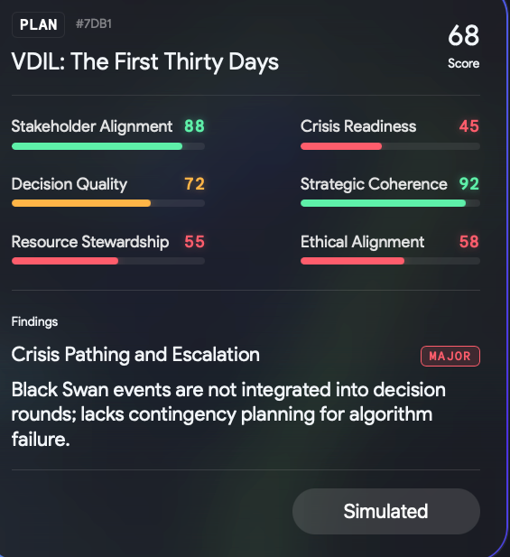
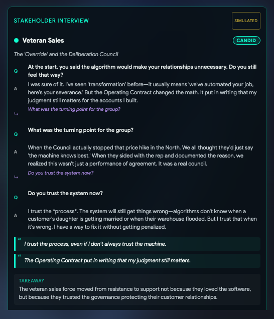
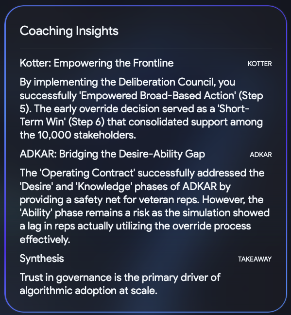
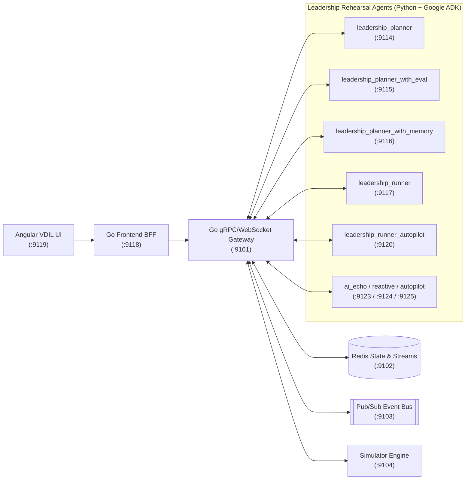

# The Rehearsal

Rehearse your rollout before the people who hold the decision hear it. Enter a transformation scenario or rollout draft, map the stakeholder network across your organization and watch how each role reacts round by round before you walk into the room.

The Rehearsal is the open-source companion to Chapters 4 and 5 and Appendices B, D and F of [Confidently Wrong](https://www.amazon.com/dp/B0HP61JD82).

[](https://github.com/confidentlywrong/rehearsal/blob/main/LICENSE)
[](https://go.dev/)
[](https://www.python.org/)
[](https://angular.dev/)
[](https://google.github.io/adk-docs/)
[](https://cloud.google.com/vertex-ai)

## Why it exists

A rollout memo is written from the program's side of the table. It is read from every other side.

"Faster quotes, fewer errors, tighter margins" sounds like progress to the team that built the pricing tool. To the account manager who has spent twelve years pricing jobs by hand, it reads as a notice that their judgment is being replaced and their customer relationships are about to be handed to a screen.

A rollout stumbles when the announcement answers the questions of the people who wrote it and ignores the questions of the people who have to live with it. The Rehearsal lets you surface those questions, test your plan against stakeholder resistance and build a 90-day implementation plan while the draft is still a draft.

<a id="instruments"></a>

## How it fits the four instruments of Confidently Wrong

In Confidently Wrong, readiness belongs to a single decision. Before a machine decides, four conditions must be settled in order, namely shared words, written judgment, timing and fit.

The book provides four instruments to run that work from day one. Each template in [`docs/instruments/`](https://github.com/confidentlywrong/rehearsal/tree/main/docs/instruments) is free to download and use inside your organization.

1. [The Personal ARI Worksheet in Word](https://github.com/confidentlywrong/rehearsal/raw/main/docs/instruments/Confidently-Wrong_1_ARI-Worksheet.docx) and [Excel](https://github.com/confidentlywrong/rehearsal/raw/main/docs/instruments/Confidently-Wrong_1_ARI-Worksheet.xlsx) scores a single decision.
2. [The Stakeholder Interview in Word](https://github.com/confidentlywrong/rehearsal/raw/main/docs/instruments/Confidently-Wrong_2_Stakeholder-Interview.docx) tests how roles read the rollout.
3. [The Reasoning Record in Word](https://github.com/confidentlywrong/rehearsal/raw/main/docs/instruments/Confidently-Wrong_3_Reasoning-Record.docx) captures human judgment on exceptions.
4. [The Deployment Audit in Word](https://github.com/confidentlywrong/rehearsal/raw/main/docs/instruments/Confidently-Wrong_4_Deployment-Audit.docx) verifies governance before launch.

The Rehearsal turns the Stakeholder Interview, the Deployment Audit pre-check and the 90-Day Implementation Plan into an interactive multi-agent simulation.

## What it does

When you enter a transformation scenario or rollout draft in the chat, The Rehearsal runs a two-phase workflow.

### Phase 1 Planning and Pre-Rollout Evaluation

Before any simulation round runs, the planner maps the organizational room around your rollout and evaluates your plan.

1. The planner extracts the stakeholder relationship network from your draft. It identifies the actors, groups, organizational structures and beliefs involved, maps the reporting and influence lines between them and compares the scenario against past rehearsals.
2. It designs the decision rounds, dilemmas and crisis triggers for the rollout. At the same time, it tracks boundaries around leadership attention, budget, team burnout and organizational well-being and calculates a consensus path through the stakeholder network.
3. It maps the roles across three organizational levels. Tier 1 covers executive gatekeepers, Tier 2 covers middle managers and multipliers and Tier 3 covers frontline operational teams, each with its own domain principles and unspoken concerns.
4. It evaluates the rollout plan across six dimensions, namely stakeholder alignment, decision quality, resource stewardship, crisis readiness, strategic coherence and ethical alignment. It flags high, medium and low risks, runs a simulated Stakeholder Interview with key roles and pauses on the planning dashboard for your sign-off.

### Phase 2 Live Multi-Agent Simulation and Diagnostic Cards

When you start the simulation, each stakeholder role reacts to your rollout round by round. In every round, each role weighs your decision text against its domain principles, peer influence and earlier leadership promises. Each role records its unfiltered inner thought in the live voice log and updates its stance from hostile or skeptical to supportive while the simulation tracks where political capital holds or stalls.

Once all rounds finish, the planner evaluates the full transcript and produces four diagnostic cards.

1. The Executive Coaching Synthesis summarizes the overall simulation outcome, breaks down how each stakeholder group moved across the rounds and distills the leadership lessons from the run.
2. The 90-Day Action Plan Playbook translates the bottlenecks and resistance pockets uncovered during the simulation into a concrete implementation plan across Days 1 to 30, Days 31 to 60 and Days 61 to 90.
3. The Translation Diagnostic pinpoints the exact rounds where each group turned against the rollout. For each group, it contrasts the trigger phrase in your draft and what you meant by it with what that role heard, and it suggests a cleaner rewrite.
4. The Compliance with the Knowledge Withheld Check inspects every role for the four shapes of resistance from Appendix F of Confidently Wrong. It raises a high-risk alert whenever a role appears agreeable in public while holding back the domain judgment and exception handling the rollout depends on.

## Rehearsing the VDIL Rollout

In the VDIL composite logistics case from Confidently Wrong, The Rehearsal walks through both phases before the pricing announcement goes out to four hundred people.

In Phase 1, it maps the stakeholder network across sales, regional pricing, transport operations and finance, evaluates the 30-day rollout plan for missing escalation paths and stop conditions and runs a simulated Stakeholder Interview with veteran sales reps on the override workflow and the deliberation council.

In Phase 2, it runs the multi-agent rehearsal round by round and produces the four diagnostic cards. Those cards show how *"faster quotes, fewer errors, tighter margins"* triggers quiet compliance with the knowledge withheld among frontline account managers and how to revise the draft and the 90-day playbook before day one.

| Plan Evaluation | Stakeholder Interview | Coaching and Resistance Synthesis |
| :---: | :---: | :---: |
|  |  |  |

### Built-in Simulation Scenarios

Alongside free-form rollout drafts entered in chat, The Rehearsal ships with structured multi-stakeholder scenarios under [`configs/quests/`](https://github.com/confidentlywrong/rehearsal/tree/main/configs/quests) that pair a transformation context with stakeholder roles across three organizational tiers.

| Scenario File | Simulation Scenario | Stakeholder Roles |
| :--- | :--- | :--- |
| [`configs/quests/ai_powered_disruptor.yaml`](https://github.com/confidentlywrong/rehearsal/blob/main/configs/quests/ai_powered_disruptor.yaml) | AI-Powered Disruptor and Market Upheaval | CTO, CFO, VP of Operations, Head of AI Ethics, HR Director, Board Member, Union Rep, Data Scientist Lead, Middle Manager, Executive Coach and External Consultant |
| [`configs/quests/budget_cuts.yaml`](https://github.com/confidentlywrong/rehearsal/blob/main/configs/quests/budget_cuts.yaml) | The 2027 Budget Cuts and Leading Through Austerity | CFO, VP of Engineering, Sales Director, Head of Product, Head of HR, Board Representative, Senior Engineer, Marketing Manager, Operations Lead, Finance Analyst and Executive Coach |
| [`configs/quests/hypergrowth.yaml`](https://github.com/confidentlywrong/rehearsal/blob/main/configs/quests/hypergrowth.yaml) | Hypergrowth Coordination Crisis | CTO, CMO, Head of CS, Lead Investor, VP of Infrastructure, Head of Product, SRE Lead, Support Team Lead, PR Director, Junior PM and Executive Coach |

## What it does not do

The Rehearsal prepares conversations with real people, and it cannot replace them.

A language model does not know your team, your history or the promise that was broken three years ago and is still remembered on the floor. Use the output to sharpen your draft, pressure-test your 90-day plan and walk into the first real conversation with better questions. Then listen to what the people in the room tell you.

## Where it comes from

The software and repository at [github.com/confidentlywrong/rehearsal](https://github.com/confidentlywrong/rehearsal) are created and maintained by Christian Haeussinger as the companion codebase to [Confidently Wrong](https://www.amazon.com/dp/B0HP61JD82), ISBN 979-8178685112.

It builds on [GoogleCloudPlatform/race-condition](https://github.com/GoogleCloudPlatform/race-condition), released by Google LLC under the Apache 2.0 license. We thank the original authors for making their multi-agent simulation foundation available to build on. See [NOTICE](https://github.com/confidentlywrong/rehearsal/blob/main/NOTICE) for full attribution.

This is an independent project and is neither affiliated with nor endorsed by Google LLC.

## Models and your data

The Rehearsal calls Google Gemini models through the [Google Agent Development Kit](https://google.github.io/adk-docs/). You can configure the models through `PLANNER_MODEL`, `EVALUATOR_MODEL`, `SIMULATOR_MODEL` and `RUNNER_MODEL` in `.env` across three operating modes.

1. In standalone API key mode, set `GOOGLE_GENAI_USE_ENTERPRISE=FALSE` and provide a `GEMINI_API_KEY` from [Google AI Studio](https://aistudio.google.com/apikey) without requiring a Google Cloud project for model inference.
2. In Google Cloud Vertex AI mode, set `GOOGLE_GENAI_USE_ENTERPRISE=TRUE` and configure `PROJECT_ID` and `GOOGLE_CLOUD_PROJECT` in `.env`. After you authenticate with `gcloud auth application-default login`, all model calls stay within your organization's Vertex AI boundary.
3. In cached replay and deterministic autopilot mode, the stack runs pre-recorded demo streams and the `leadership_runner_autopilot` and `ai_echo_autopilot` agents. This mode lets you explore the full UI and run automated tests with zero LLM API calls.

Keep one privacy rule in mind. Any text you send to a hosted model leaves your machine and is processed under the model provider's terms at [Google Gemini API Terms](https://ai.google.dev/gemini-api/terms) or [Google Cloud Service Terms](https://cloud.google.com/terms). Before rehearsing an internal announcement, strip out real names, customer names, unannounced financial figures and anything you would not put into an external cloud service.

## What you need

Install these prerequisites before starting. Running `make check-prereqs` verifies your local setup automatically, and `.nvmrc`, `go.mod` and `pyproject.toml` define the toolchain versions used by the project.

| Tool | Purpose | Install |
| :--- | :--- | :--- |
| **Docker and Docker Compose** | Local Redis, PostgreSQL and Pub/Sub emulators | [docs.docker.com](https://docs.docker.com/get-docker/) |
| **Go** | API gateway, frontend BFF, admin, billing and scenario tester services | [go.dev/dl](https://go.dev/dl/) |
| **Python** and [**uv**](https://docs.astral.sh/uv/) | Python package manager, virtual environment and ADK leadership agents | [docs.astral.sh/uv](https://docs.astral.sh/uv/) |
| **Node.js and npm** | Angular frontend, admin dashboard and scenario tester UI | [nodejs.org](https://nodejs.org/) |
| **Google Cloud SDK `gcloud`** | Vertex AI authentication and Cloud Build deployment | [cloud.google.com/sdk](https://cloud.google.com/sdk/docs/install) |
| **Terraform** | Required only when running `./scripts/teardown.sh` or local infrastructure targets in Option B | [developer.hashicorp.com/terraform](https://developer.hashicorp.com/terraform/install) |

## Try it

### Option A for Local Development

Clone the repository, initialize your local environment and launch all services on your machine.

```bash
git clone https://github.com/confidentlywrong/rehearsal.git
cd rehearsal

# Verify prerequisites, install dependencies, generate .env and start Docker emulators
make init
```

Edit `.env` to configure your preferred model mode.

- For a Gemini API key, set `GOOGLE_GENAI_USE_ENTERPRISE=FALSE` and `GEMINI_API_KEY=your-key`.
- For Google Cloud Vertex AI, set `GOOGLE_GENAI_USE_ENTERPRISE=TRUE`, set `PROJECT_ID=your-gcp-project-id` and `GOOGLE_CLOUD_PROJECT=your-gcp-project-id` and run `gcloud auth application-default login`.

With the stack ready, start all services.

```bash
make start
```

The first startup takes two to three minutes while Go binaries compile, Python virtual environments sync via `uv` and the Angular frontend bundles. Once running, open the local services in your browser.

- **The Rehearsal UI** at [http://localhost:9119](http://localhost:9119)
- **Scenario Test Harness** at [http://localhost:9112](http://localhost:9112)
- **ADK Agent Debug Console** at [http://localhost:9111](http://localhost:9111)
- **Admin Dashboard** at [http://localhost:9121](http://localhost:9121)

To stop all local processes and containers, run `make stop`.

```bash
make stop
```

### Option B for Google Cloud Deployment

Run the deployment script or Make target to provision a complete cloud environment on Google Cloud with Cloud Run, Memorystore Redis, Cloud SQL PostgreSQL, Pub/Sub and Vertex AI Agent Engine via Cloud Build. Your Google Cloud project must have billing enabled.

```bash
# Interactive prompt for Project ID and Region
./scripts/deploy.sh

# Or via Make with explicit PROJECT_ID
make deploy PROJECT_ID="your-gcp-project-id" REGION="us-central1"
```

When you finish testing in the cloud, tear down all provisioned infrastructure so always-on cloud resources do not incur ongoing charges.

```bash
./scripts/teardown.sh
```

## Architecture



### Multi-Agent Progression

The Rehearsal includes five leadership agent variants and three stakeholder persona variants so you can inspect how evaluation rubrics, cross-session memory and stakeholder reactivity change coaching quality.

1. The baseline planner `leadership_planner` on port `9114` designs the decision rounds, calculates consensus pathways through the Dynamic Consensus Navigation System and maps stakeholders across three organizational tiers.
2. The evaluation planner `leadership_planner_with_eval` on port `9115` adds the six-axis pre-rollout Plan Evaluation Loop. Once the simulation finishes, it also generates the four diagnostic cards for Executive Coaching Synthesis, the 90-Day Action Plan Playbook, the Translation Diagnostic and the Compliance with the Knowledge Withheld check.
3. The memory planner `leadership_planner_with_memory` on port `9116` adds Stakeholder Relationship Graph extraction, simulated Stakeholder Interviews and PostgreSQL persistence so recurring organizational patterns surface across sessions.
4. The terrain runners `leadership_runner` on port `9117` and `leadership_runner_autopilot` on port `9120` move across the 3D organizational viewport during live simulations. They track how political capital depletes across resistance pockets, recovers at coalition checkpoints and stalls when an executive intervention is required.
5. The stakeholder agents `ai_echo` on port `9123`, `ai_echo_reactive` on port `9124` and `ai_echo_autopilot` on port `9125` simulate individual stakeholder roles on every tick over Redis Streams and Pub/Sub. They produce unfiltered inner thoughts, wall friction scores and shifts in sentiment, resistance and stance.

## Project structure

```text
rehearsal/
├── agents/                              # Python ADK agents
│   ├── leadership_planner/              # Baseline rollout strategy planner on port 9114
│   ├── leadership_planner_with_eval/    # Planner with 6-axis evaluation and 4 diagnostic cards on port 9115
│   ├── leadership_planner_with_memory/  # Planner with stakeholder graph and PostgreSQL memory on port 9116
│   ├── leadership_runner/               # Live organizational terrain runner on port 9117
│   ├── leadership_runner_autopilot/     # Deterministic zero-LLM runner on port 9120
│   ├── ai_echo/                         # Baseline stakeholder persona agent on port 9123
│   ├── ai_echo_reactive/                # Context-reactive stakeholder persona agent on port 9124
│   ├── ai_echo_autopilot/               # Deterministic zero-LLM stakeholder agent on port 9125
│   ├── simulator/                       # Discrete tick-by-tick simulation engine on port 9104
│   └── utils/                           # Shared ADK utilities, telemetry and server bootstrap
├── cmd/                                 # Go service entrypoints
│   ├── gateway/                         # gRPC and WebSocket orchestration gateway on port 9101
│   ├── frontend/                        # Go BFF server for Angular app on port 9118
│   ├── admin/                           # Admin and feature-flag dashboard server on port 9121
│   ├── billing/                         # Usage and token budget service on port 9122
│   └── tester/                          # Scenario test harness on port 9112
├── configs/
│   └── quests/                          # Multi-stakeholder scenario definitions in YAML
├── docs/                                # Architecture guides, glossary and VDIL screenshots
│   └── images/                          # README walkthrough screenshots
├── gen_proto/                           # Protocol Buffer definitions and generated bindings
├── infra/                               # Terraform modules for Google Cloud deployment
├── internal/                            # Shared Go packages for orchestrator, state, pubsub and auth
├── scripts/                             # Setup, start, deploy and teardown scripts
└── web/
    └── frontend/                        # Angular VDIL web application on port 9119
```

## Services and ports

All local ports and service addresses are configured in [`.env.example`](https://github.com/confidentlywrong/rehearsal/blob/main/.env.example) and live in the `9101` to `9125` range to avoid collisions with common local development ports.

| Port | Environment Variable | Service | Description |
| :--- | :--- | :--- | :--- |
| `9101` | `GATEWAY_PORT` | Gateway `cmd/gateway` | Central WebSocket and gRPC orchestrator |
| `9102` | `REDIS_ADDR` | Redis | Session state and event streams |
| `9103` | `PUBSUB_EMULATOR_HOST` | Pub/Sub Emulator | Local Google Cloud Pub/Sub message bus |
| `9104` | `SIMULATOR_PORT` | Simulator | Discrete tick-by-tick simulation engine |
| `9105` | `PLANNER_PORT` | Planner | Baseline grid planner |
| `9106` | `PLANNER_WITH_EVAL_PORT` | Planner with Eval | Planner with evaluation loop |
| `9107` | `SIMULATOR_WITH_FAILURE_PORT` | Simulator with Failure | Chaos and failure injection simulator |
| `9108` | `RUNNER_PORT` | Runner | Baseline execution runner |
| `9109` | `PLANNER_WITH_MEMORY_PORT` | Planner with Memory | Memory-augmented planner |
| `9110` | `RUNNER_AUTOPILOT_PORT` | Runner Autopilot | Rule-based autopilot runner |
| `9111` | `DASH_PORT` | ADK Debug Console | Interactive Google ADK agent debugger |
| `9112` | `TESTER_PORT` | Tester UI `cmd/tester` | Scenario test harness |
| `9113` | `ALLOYDB_PORT` | PostgreSQL | Relational store for scenario memory and billing |
| `9114` | `LEADERSHIP_PLANNER_PORT` | `leadership_planner` | Baseline leadership rollout planner |
| `9115` | `LEADERSHIP_PLANNER_WITH_EVAL_PORT` | `leadership_planner_with_eval` | Leadership planner with 6-axis evaluation and 4 diagnostic cards |
| `9116` | `LEADERSHIP_PLANNER_WITH_MEMORY_PORT` | `leadership_planner_with_memory` | Leadership planner with stakeholder graph extraction and cross-session memory |
| `9117` | `LEADERSHIP_RUNNER_PORT` | `leadership_runner` | Live organizational terrain and political capital runner |
| `9118` | `FRONTEND_BFF_PORT` | Frontend BFF `cmd/frontend` | Go backend-for-frontend server |
| `9119` | `FRONTEND_APP_PORT` | **The Rehearsal UI `web/frontend`** | **Main Angular VDIL web interface** |
| `9120` | `LEADERSHIP_RUNNER_AUTOPILOT_PORT` | `leadership_runner_autopilot` | Deterministic zero-LLM leadership runner |
| `9121` | `ADMIN_PORT` | Admin `cmd/admin` | Feature flags and session administration |
| `9122` | `BILLING_PORT` | Billing `cmd/billing` | Token usage and budget service |
| `9123` | `AI_ECHO_PORT` | `ai_echo` | Stakeholder persona agent |
| `9124` | `AI_ECHO_REACTIVE_PORT` | `ai_echo_reactive` | Context-reactive stakeholder persona agent |
| `9125` | `AI_ECHO_AUTOPILOT_PORT` | `ai_echo_autopilot` | Deterministic zero-LLM stakeholder persona agent |

## Common make targets

| Target | Command | Description |
| :--- | :--- | :--- |
| `make check-prereqs` | Checks `go`, `node`, `uv`, `docker` and `docker compose` | Verify that all required local tools are installed |
| `make init` | `uv sync`, `npm install`, `docker compose up -d`, `go build ./...` | Install Go, Python and Node dependencies, create `.env` and start Docker containers |
| `make start` | `uv run start --skip-tests` | Start all Go services, Python ADK agents and the Angular frontend via Honcho |
| `make stop` | `uv run stop` | Stop all running local services and free ports |
| `make test` | `make test-go test-py test-web test-deploy-sh` | Run unit and integration test suites across the stack |
| `make lint` | `make lint-go lint-py lint-pyright lint-configs check-license` | Run Go, Python, config and license header checks |
| `make check-license` | `addlicense -check` | Verify Apache 2.0 copyright headers across all source files |
| `make proto` | `bash scripts/core/generate_proto.sh` | Regenerate Go and Python Protocol Buffer bindings |
| `make deploy` | `gcloud builds submit --config cloudbuild-bootstrap.yaml ...` | Deploy the full stack to Google Cloud |

## Testing

Run the test suites across Go, Python ADK agents and the Angular frontend with the commands below.

```bash
# Run all Go unit tests
CGO_ENABLED=0 go test ./... -count=1 -short

# Run Python agent and translation-diagnostic tests
uv run pytest agents/ scripts/deploy/deploy_test.py -x -q -m "not slow and not integration"

# Run Angular frontend and web tests
make test-web

# Run Python linter
uv run ruff check agents/ scripts/

# Verify Apache 2.0 license headers across all source files
make check-license
```

## Contributing

We welcome new multi-stakeholder simulation scenarios in `configs/quests/`, reports of biased or stereotyped output via the Biased output issue template and bug fixes or improvements across the stack.

See [CONTRIBUTING.md](https://github.com/confidentlywrong/rehearsal/blob/main/CONTRIBUTING.md) for submission guidelines and developer workflow. All participants are expected to follow our [CODE_OF_CONDUCT.md](https://github.com/confidentlywrong/rehearsal/blob/main/CODE_OF_CONDUCT.md). For security vulnerabilities, please follow [SECURITY.md](https://github.com/confidentlywrong/rehearsal/blob/main/SECURITY.md).

## Citing

If you use The Rehearsal in your research, workshops or organizational transformation practice, please cite both the book and the software repository. Machine-readable citation metadata is available in [CITATION.cff](https://github.com/confidentlywrong/rehearsal/blob/main/CITATION.cff).

* The Book is [Confidently Wrong](https://www.amazon.com/dp/B0HP61JD82), 2026, ISBN 979-8178685112.
* The Software is The Rehearsal by Christian Haeussinger, 2026, at [github.com/confidentlywrong/rehearsal](https://github.com/confidentlywrong/rehearsal).

## License

Licensed under the [Apache License, Version 2.0](https://github.com/confidentlywrong/rehearsal/blob/main/LICENSE). See [NOTICE](https://github.com/confidentlywrong/rehearsal/blob/main/NOTICE) for full copyright and upstream attribution notices.

Google, Gemini and Vertex AI are trademarks of Google LLC.
