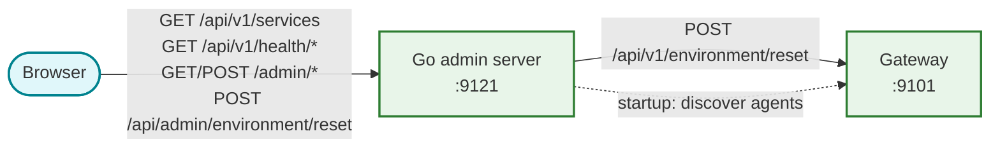

# Admin dashboard

Vanilla JavaScript SPA for simulation monitoring, user management, audit inspection, and environment management.
Bundled with Vite, zero runtime dependencies. Served by the Go admin server
([cmd/admin/](../../cmd/admin/)).

## What it shows

A single-page monitoring portal using an Obsidian Light left-sidebar shell with four views:

**Header**: "System Overview" top bar with a live `StatusLabel` showing how many core services are online or surfacing explicit probe errors.

**Health**: service cards organized by category (Admin & System, Core Infrastructure, AI Agents, Developer UIs, Frontend). Each card shows a health indicator dot, description, and a link for browseable services. Agent Engine agents get an "AE" badge. The service list is fetched from the admin server's `/api/v1/services` endpoint -- not hardcoded in the frontend.

**Environment management**: checkboxes for Sessions, Spawn Queues, and Session Maps, plus a "Reset Environment" button guarded by an Obsidian `<dialog>` confirmation sheet that POSTs to the authenticated admin BFF `/api/admin/environment/reset` endpoint.

**Users, Audit & Operations**: superadmin management views backed by `/admin/users`, `/admin/audit`, `/admin/billing/reconcile`, and `/admin/users/hard-delete`.

**Footer**: copyright and a "Last Check" timestamp updated every 5 seconds.

## Data flow

The dashboard talks to the Go admin server on the same origin, which proxies environment reset to the Gateway:



- **Read & management operations** go to the same-origin Go admin server (`cmd/admin`, port `9121`), including authenticated `POST /api/admin/environment/reset` which forwards to the Gateway (`cmd/gateway`, port `9101`)
- Runtime configuration comes from `/config.js` which the admin server generates with `window.ENV` containing all service URLs

## Health polling

Health is checked every 5 seconds via two admin server endpoints:

| Endpoint | What it checks |
|:---------|:---------------|
| `/api/v1/health/infra` | Redis, Pub/Sub, AlloyDB (admin server pings directly) |
| `/api/v1/health/services` | All registered services' `/health` endpoints (concurrent, 5s timeout) |

The dashboard updates each card's health indicator dot (green/red/grey) based on the combined results and surfaces an explicit error banner if any probe fails.

## Running locally

```bash
npm install
npm run dev     # Vite dev server on :8000, proxies /api, /admin, /config.js to admin :9121
npm run build   # Production bundle (output: dist/, served by cmd/admin)
npm run typecheck
npm test        # Vitest + jsdom
```

In dev mode, Vite proxies `/api`, `/admin`, and `/config.js` requests to `127.0.0.1:9121` (`cmd/admin`).
In production, the Go admin server handles its own `/api/v1/*`, `/api/admin/*`, and `/admin/*` routes and serves the built assets from `dist/`.

## File layout

```
web/admin-dash/
├── index.html          # HTML shell (sidebar, topbar, view containers, footer)
├── main.js             # Health polling, BFF reset, sidebar routing, lazy tab mounting
├── api.js              # Same-origin admin API client with local-dev superadmin gating
├── confirm-sheet.js    # Native <dialog> Obsidian confirmation sheet
├── users.js            # User approval, plan tiers, GDPR actions
├── audit.js            # Paginated audit log viewer
├── ops.js              # Billing reconcile and hard-delete sweep
├── style.css           # Apple HIG Obsidian Light & 5-Layer Liquid Glass styles
├── vite.config.ts      # Dev server config + admin BFF proxy (:9121)
├── vitest.config.js    # Test config (jsdom environment)
├── package.json        # Zero runtime deps, Vite + Vitest + TypeScript devDeps
└── __tests__/          # Unit & regression test suites
```

## Further reading

- The Go admin server ([cmd/admin/](../../cmd/admin/)) serves this SPA and provides the monitoring & BFF APIs
- The gateway ([cmd/gateway/](../../cmd/gateway/)) handles upstream environment reset requests
